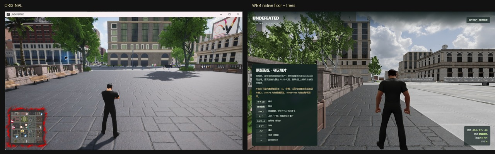
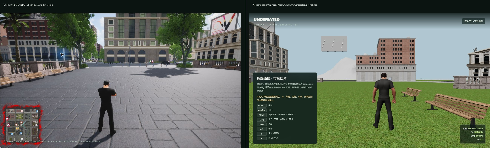

# 可玩原版基线 B1/B2/B3：原街区、原角色、原输入、战斗与动态碰撞

日期：2026-10-25。入口：`http://127.0.0.1:5178/?view=play`；可用 `&district=TitleMenuLevel` 等主世界关卡切换检查目标（预览人口只在 ResidentialArea1 加载）；`&startup=1` 先执行原 17 包启动链再进入可玩模式；`&plaza=1` 是 MainLevel 起点广场预览预设（启动链 + `(20,0)` + 原生楼板/树木）；`&mode=free` 开启自由破坏预览（非默认原版基线）。

这是**可玩切片**，不是完整 UNDEFEATED 移植。B1 把原角色放回恢复后的原版街区，用原高度场和原输入语义驱动；B2 增加预览人口、原战斗动画/弹道和相机遮挡收缩。攻击命中、AI、任务、Boss、菜单/存档、完整动画状态机和同机位对照仍需继续。

## 本次接入

- 世界：`MainLevel + ResidentialArea1` 静态装配，3,782 个源对象组件、144 块地形；资源/纹理失败 0。
- 角色：`/assets/character/hero.gltf`，原身体/头发/墨镜三套网格与骨架，18 段原动画；保留原骨架与比例。
- 地面：144 块原 Landscape 高度场逐点采样（`TerrainHeightfield`），不是旧的单平面地面。
- 可走楼板：`tools/asset-pipeline/export-walkable-surfaces.mjs` 从 `/Mesh/Floor/` 资产导出 29 个世界 AABB 顶面；玩家支撑高度取地形与楼板顶面的较高者，因此可以站上恢复出的砖/石广场地面。`SM_Floor12000x15000` 原本是 thin-instanced mesh，在 Babylon 路径中 thin 实例不绘制；运行时把每个实例矩阵的平移/缩放/旋转复制成普通 mesh clone，原生 `MI_FloorBrick1` 地面现在可见（`play-floor-fixed.jpg`、`play-plaza-nativefloor.jpg`）。同一材质化管线也应用到 `Bench` 和出生点 120 m 内的 `Tree/Palm` thin 实例。`?at=<x,z>&yaw=<rad>&exact=1` 可把出生点/朝向精确放到指定点做取景检查（绕过安全环搜索），例如 `?view=play&plaza=1&at=-30,-4&yaw=0&exact=1`（`play-plaza-trees2.jpg`）。
- 碰撞：从恢复后的静态对象 TRS 与 asset bounds 生成 1,432 个 AABB 代理（2,171 个对象中跳过 731 个过小、8 个过大）；这是可玩性代理，不是原 cooked PhysX。相机偏移会对附近 AABB 做收缩，避免穿墙。所有存活预览 actor（含市民、车辆、报刊箱）的 `solidBoxes` 每帧加入玩家动态碰撞。
- 相机：第三人称按原 `PlayerBP` `CameraBoom` 的 `TargetArmLength=400 cm`、`SocketOffset=(0,50,90) cm`、`RelativeLocation Z=70 cm` 校准，并按 HeroRank 0 的 `Camera.FieldOfView=92°` 水平视场换算（rank 表 92/94/96/98/100/100/100）；使用原 `CameraLagSpeed/RotationLagSpeed=15` 做相机位置/朝向平滑。攻击时目标臂长按 HeroComponent AST 的 650 cm 插值（`CameraInterpSpeed=2`）；`CharacterSpeed > 6000 cm/s` 时切到 FarArmLength=800 cm、FarCameraInterpSpeed=1；相机还钳制在地形上方 0.3 m。HeroComponent 的其它 HPS Far/Zoom 状态、弹簧回弹和碰撞后处理仍是近似。
- 输入：Space 地面跳跃 / 空中开飞 / 飞行退飞；E/Q 升降；地面按住 E 约 1 秒自动开飞；Shift 冲刺；Alt 慢行；F 预留互动；R 为调试回出生点。按 P07，Shift 只有与移动输入同时存在才进入冲刺；松开 Shift/停止移动即解除，Alt 慢行取消冲刺。按 P08，冲刺速度跌到 850 cm/s（步行）/2000 cm/s（飞行）以下会重置，且保持 Shift 不会立即重新触发。加速度使用原值：步行 2048 cm/s²、飞行 4096 cm/s²、冲刺 15000 cm/s²；楼板/台阶支撑使用 MaxStepHeight=75 cm。
- 动画：`Hero_Idle`、`A_ThirdPersonRun`、`Hero_IdleFlying`、`Hero_FlyFastSprint` 随状态切换；B1 实测前三条。
- 出生点：旧原型街区局部坐标 `(50, 1.37)` 加上 city manifest `originUE [-10000,-55000,0]` cm，得到恢复世界 `(-50.0, -548.63)`，位于 ResidentialArea1 的实际公寓街区；仍不是原 `PlayerStart`。MainLevel `BP_RespawnAndSpawnPoint` 的 x/z 作为备用。其他 `district=` 关卡从 bounds 中心向外按 3 m 环搜索最多 30 m，取第一个不在静态 AABB 内的地形点。
- B2 预览人口：14 个 actor（8 市民、3 Sedan、3 报刊箱），使用原 citizen/vehicle/NewspaperBox 网格与动画；位置来自旧原型 `population-manifest.json`，按同一 `originUE` 平移到恢复世界。市民短路线优先用最近的原版 `BP_CharaChildWaypoint`（同父优先），但路线顺序/遍历、AI/导航/交通仍非原版。free 模式下市民死亡 8 秒后在原 spawn 点复活，是预览城市生命周期，不是原版 spawner 节奏。车辆在另一辆车前方 7 m 内会停车保持间距，并在玩家进入前方 5 m 时让行，这是预览交通规则，不是 `BP_TrafficSystem` 状态机。
- B2 战斗：接入原 14 段动作时间轴与攻击动画；左键/J 四段近战，右键/K 远程拳波，Shift 强攻；弹体 150 m/s、4 s 寿命。默认 `baseline` 伤害模式：只有强力攻击可摧毁车辆；可选 `mode=free` 才启用市民/道具/车辆自由破坏。
- 热视线：按住 **Shift+E**（预览）；Shift 同时抑制 E 的升降/地面蓄升，E 单独仍是原版上升/蓄升键。原版右键远程攻击保留。

## 已实测

浏览器探针 [probe-play-b1.js](../scripts/probe-play-b1.js)：

- 地面待机：`Hero_Idle`，grounded=true；
- 按 W 0.7 秒：移动 6.44 m，速度 10 m/s，`A_ThirdPersonRun`；
- Space：跳起约 3.88 m（原 JumpZVelocity=2000 cm/s、GravityScale=5），随后空中 Space 进入飞行；
- 飞行中按住 E 0.45 秒：上升 13.83 m（速度 40 m/s）；按住 Q 0.7 秒下降 7.33 m；
- 飞行中 Space：退出飞行并落回地面；
- 全程 `objects=3782`、`terrain=144`、资源/纹理失败 0。

B2 探针 [probe-play-b2.js](../scripts/probe-play-b2.js) / [probe-play-b2-hit.js](../scripts/probe-play-b2-hit.js)：

- 近战：`近战连击` + `Hero_Attack1`，结束后回到 `待命`/`Hero_Idle`；
- 远程：`远程攻击` + `Hero_LongFistForce_L`，生成 1 个弹体；
- 强力远程命中预览车辆：剩余 actor 14 → 11、hits 0 → 3、destroyed 0 → 3，最近车辆 alive=false；
- 按住 E：`heatActive=false`，地面蓄升 charge 正常累加；
- 相机位置不在任何 AABB 内（cameraInside=false）。

单测 [test-play-controller.mjs](../scripts/test-play-controller.mjs) 11/11：地面/行走方向、原跳速/重力顶点、跳跃/开飞/退飞、Shift+E 不蓄升、地面蓄升 1 秒边界、冲刺/慢行/升降、Shift 必须配合移动输入、P08 冲刺速度重置、楼板支撑行走、动态车辆 AABB 阻挡、R 重置；原 14 段战斗时间轴由 `npm test` 覆盖。

截图：[play-b1.jpg](../research/screenshots/play-b1.jpg)、[play-b2.jpg](../research/screenshots/play-b2.jpg)、[play-b3.jpg](../research/screenshots/play-b3.jpg)。记录：[playable-b1-validation.json](../research/world-recovery/playable-b1-validation.json)、[playable-b2-validation.json](../research/world-recovery/playable-b2-validation.json)。

## 交通/人行横道可视化（可选）

```text
/?view=play&traffic=1
```

- 从 MainLevel 几何中恢复 **227 个 CrossWalk** 与 **339 个 TrafficLight** 网格位置；
- `traffic=1` 绘制 227 个人行横道位置的黄色圆环；
- HUD 同时显示最近人行横道距离（实测 4.3 m）；
- 车辆已有 7 m 车距停车与玩家前方 5 m 让行，但**原版红绿灯时序、`BP_TrafficSystem` 状态机和路线遍历未恢复**。

脚本：`tools/asset-pipeline/export-traffic-markers.mjs`；证据：`research/world-recovery/traffic-markers.json`。截图 `play-traffic-crosswalk4.jpg`、`play-traffic-hud.jpg`。

## 任务触发区域可视化（可选）

```text
/?view=play&quests=1
```

- 从 MainLevel 解码出 21 个 `FireQuest_BP`/`MatQuest_BP` 触发区域；
- 橘色圆环 = FireQuest，蓝色圆环 = MatQuest；
- 位置来自 actor root 的 `RelativeLocation`，半径来自 Sphere/Box 组件；
- 靠近 6 m 内自动标记为**已发现**，HUD 显示 `任务区域 x/21`；
- 按 F 显示“任务区域 · <actor> · 原版任务状态未恢复”；
- 原版任务状态机、完成条件、奖励和任务 UI 未恢复，F 不会真正完成任务。

脚本：`tools/asset-pipeline/export-quest-areas.mjs`；证据：`research/world-recovery/quest-areas.json`。截图 `play-quest-marker.jpg`、`play-quest-visit.jpg`。

## Homelander 换模（真实模型）

```text
/?view=play&skin=homelander
```

- 加载用户提供的 `homelander.glb`（约 29 MB，原模型自带贴图、披风、红靴和骨架）；
- 不再复用原角色的身体/服装/墨镜；
- 原版 `?view=play` 仍使用原角色和原 18 段动画，默认不受影响；
- Shift+E 热视线、右键远程、`mode=free` 均保留。


### 动作处理

Homelander GLB 自带 idle/jog/sprint/fly/hover/punch/combo 等动画。若把原版动画直接重定向到它的 T-pose 骨架，实测手臂/肩部会出现畸形；因此当前默认：

- 保留原版**动作名、状态机、攻击时间轴、连招、相机和输入**；
- 把原版动作名映射到 Homelander 自带的对应动作（idle→idle，run→jog，fly→fly，Attack→punch/combo 等）；
- 原角色仍使用原版动画，未修改。

这保证默认 H 模型无畸形，但不是“原版动作逐帧重定向”。实验性重定向保留在 `?retarget=1`，当前不推荐。

### 边界

- 动作风格来自 Homelander 模型，不是原版逐帧动作；
- 若必须逐帧保留原版动作，需要继续修正骨架 rest-pose/手臂轴重定向；
- `homelander-style.glb` 未使用。

截图 `play-homelander-final.jpg`、`play-homelander-ownrun2.jpg`、`play-homelander-ownattack.jpg`、`play-homelander-heat2.jpg`。

## 热视线预览（Shift+E）

- 按住 **Shift+E**：进入热视线，HUD/动作状态标记为热视线；
- Shift 同时抑制 E 的升降/地面蓄升；松开 Shift 后 E 恢复原版行为；
- 原版右键远程攻击不受影响；
- free 模式下可造成伤害/摧毁；baseline 模式仍按 baseline 伤害策略；
- Homelander 真实模型已接入，热视线从其头部/眼部方向发出。

浏览器探针：Shift+E 时 `heatActive=true`、`flying=false`，市民生命从 35 降到 23。


复现：

```text
node scripts/capture-world.mjs --query='view=play&mode=free' --ready=play --probe=scripts/probe-heat.js --shot=research/screenshots/play-heat-beam.jpg
```

## 自由破坏预览（可选）

```text
/?view=play&mode=free
```

- 使用 `FREE_RULES`：市民 35、车辆 100、道具 30 生命；
- 近战/远程/强力攻击可伤害并摧毁预览市民、车辆、道具；
- HUD 显示当前 `破坏/命中` 计数（实测 2/2）；
- 市民被摧毁后 8 秒在原 spawn 点复活；
- 没有玩家受伤、负分、强制失败等惩罚系统；
- 热视线 **Shift+E** 已接入预览；Homelander 真实模型已接入（动作映射见上文）；
- 默认 `?view=play` 仍是原版基线 `baseline` 模式，不伤害市民。

浏览器探针已验证：free 模式下 KeyK 攻击可把市民生命降到 0，`destroyed` 计数增加。


## B3/B4 进展

- 修正旧原型街区局部坐标：`originUE [-10000,-55000,0]` cm 使原先的 `(50,1.37)` 实际对应恢复世界 `(-50.0,-548.63)`；spawn 和 14 个预览 actor 一起平移，截图从空旷主路变为 ResidentialArea1 的实际公寓/街道（`play-b3.jpg`）。
- 预览所有存活 actor（含市民、车辆、报刊箱）的 `solidBoxes` 每帧加入玩家动态 AABB；单测新增“Shift 需移动输入”“P08 冲刺重置”“楼板支撑行走”“车辆 AABB 阻挡行走”“Shift+E 不蓄升”，目前 11/11。
- 新增 `?district=` 参数：对 MainLevel + 指定主世界关卡做装配与碰撞代理，出生点取该关卡 bounds 中心附近的地面空闲点；预览人口仍只在 ResidentialArea1 加载。`play-titlemenu.jpg` 是 TitleMenuLevel 的实际浏览器检查，不是原版开始画面。
- 新增可选 `?population=original` 检查：`tools/asset-pipeline/export-citizen-spawns.mjs` 从原版 `CitizenWayPoint` 取玩家附近 **6** 个 `BP_CharaSpawnPoint`（距玩家 ≥10 m、彼此 ≥18 m），转成恢复世界坐标，生成 `population-original-citizens.json`；路线使用最近的原版 `BP_CharaChildWaypoint`（同父优先）。原版 spawner 不会同时生成全部市民，路线顺序/遍历/AI 仍是预览，所以**默认仍用预览人口**，该模式只用于位置/路径检查（`play-child-waypoints-6b.jpg`）。

## MainLevel 起点广场候选（startup 全城）

单区 `?view=play` 在 MainLevel 原点附近只显示空广场；加上 `&startup=1` 加载 17 包后，同一位置出现古典立面、石栏杆、广告牌、城市街区和原生砖石楼板。

```text
/?view=play&startup=1&at=20,0&yaw=0
/?view=play&plaza=1
```

截图 `play-mainplaza-startup3.jpg`、`play-plaza-nativefloor.jpg`、`play-plaza-mode-native.jpg`，对照图 `comparison-start-plaza-native2.jpg`。`plaza=1` 预设使用更接近原图的开阔广场姿态 `(20,0)`：启动链 + 原生砖石楼板 + 局部树木 + 相机净空（`play-plaza-mode-native.jpg` / `comparison-start-plaza-native2.jpg`）；不改变默认出生点。

另外两个候选姿态：

- `plaza=1&at=-20,0&yaw=0`：石栏杆在右、喷泉近景，构图不如 `(20,0)` 开阔；出生点搜索现在要求角色后方 4 m 相机位不被静态 AABB 占用，因此相机不再挤进角色（`play-plaza--20-native-trees.jpg`）；
- `plaza=1&at=-10,-20&yaw=0`：干净的铺装广场，但建筑布局不同（`play-plaza-left2.jpg`）。原生楼板修复后不再默认铺 overlay；`?floors=overlay` 仍保留为可选的 `GroundBrick_B_A` 回退，用于对比测试。它比之前的 CommercialArea 候选更接近原程序起点广场的城市构图，但：

- 原生楼板已修复；overlay 只在显式 `floors=overlay` 时作为回退；
- 长椅、相机位置和建筑朝向没有逐项匹配；
- 仍是**候选**，不是同机位结论。

### 原生地面/树木候选（exact=1）

```text
/?view=play&plaza=1&at=-30,-4&yaw=0&exact=1
```

`exact=1` 跳过安全环搜索，仅用于取景检查；`arm=<m>`/`fov=<deg>` 可临时覆盖相机臂长/水平 FOV，同样只用于同机位探针，不改变默认原版参数（4 m / 92°）。现在同一画面包含：

- 原生 `MI_FloorBrick1` 大块石铺装；
- 左/中景树木（Tree/Palm thin instances 已材质化）；
- 左侧石栏杆与花箱；
- 中央/右侧古典立面。



`arm=6&fov=80` 的探针（`play-plaza-arm6b.jpg` / `comparison-start-plaza-arm6.jpg`）让角色比例更接近原图，但场景左右关系/广告牌/建筑朝向仍不同；默认相机仍使用恢复的 4 m / 92°。

仍不是同机位：原程序画面更开阔、长椅沿左栏杆排布、右侧有大幅广告牌，Web 相机/建筑朝向/植被密度与长椅位置不同。

## 起点广场候选（未证明）

在 CommercialArea 用 `?view=play&district=CommercialArea&at=91,181&yaw=3.14159` 检查到一组与原程序起点广场相似的元素：石质栏杆、古典拱窗立面、长椅和开阔广场，见 `play-plaza-190.jpg`。



但这只是**候选地点**，不是已证明的同机位：

- 原生 `MI_FloorBrick1` 楼板现在通过 thin-instance→普通 mesh materialize 可见（`play-floor-fixed.jpg`）；
- 原程序建筑位置、长椅排列、相机和光照还没有逐项匹配。

这组坐标作为下一步同机位对照的候选，而不是完成结论。楼板/草地遮挡调查见 [commercial-plaza-ground-investigation.zh-CN.md](../research/world-recovery/commercial-plaza-ground-investigation.zh-CN.md)。

## 多区可玩检查

| 区域 | 对象 | 地形 | 失败 | 截图 |
|---|---:|---:|---:|---|
| ResidentialArea1 | 3,782 | 144 | 0 | `play-b3.jpg` |
| DownTown | 4,274 | 144 | 0 | `play-downtown.jpg` |
| Park | 4,105 | 144 | 0 | `play-park.jpg` |
| CommercialArea | 4,017 | 144 | 0 | `play-commercial.jpg` |
| TitleMenuLevel | 3,469 | 144 | 0 | `play-titlemenu.jpg` |
| 17 包启动链（`startup=1`） | 8,824 | 144 | 0 | `play-startup.jpg` |

每区都使用同一原角色、原输入、原高度场和该区静态 AABB 碰撞代理；除 ResidentialArea1 外没有预览人口/战斗目标。记录见 [playable-districts-validation.json](../research/world-recovery/playable-districts-validation.json)。

## 原启动链可玩模式

`?view=play&startup=1` 先由 `OriginalStreaming` 执行恢复出的 17 包/12 步启动加载，再构建**全部启动关卡**的静态 AABB、生成原角色和预览人口。实测：

- 8,824 个源对象、144 块地形、0 资源/纹理失败；
- B1 浏览器探针通过：移动 4.62 m、跳跃约 3.85 m、E 上升 4.54 m、Q 下降 8.39 m；
- 截图 `play-startup.jpg`。

这是“原启动链 + 可玩角色”的整合检查，不代表原版运行时流送状态机、可见性或性能已等价。
- 已审计原版 `CitizenWayPoint` 解码数据：2,806 个 `BP_CharaSpawnPoint`、85 个 spline 路径 actor、559 个 child waypoint；最近 spawn 位置与玩家街区对齐（100 m 内 897 个）。但 UAssetAPI 的 actor/component Outer 链与 spline 局部坐标转换尚未闭合，本轮不把它们替换进 Population，避免用未核清坐标冒充原版路径。详见 [citizen-waypoint-audit.zh-CN.md](../research/world-recovery/citizen-waypoint-audit.zh-CN.md)。

## 明确近似与缺口

- 预览人口的位置来自旧原型清单，市民路线优先用最近原版 child waypoint；free 模式死亡后 8 秒复活是预览生命周期；车辆 7 m 间距停车、玩家前方 5 m 让行是预览规则。原版 AI/导航/交通/市民状态机和路线遍历仍未恢复，不能当作原版城市活动。
- 默认战斗仍使用 `baseline` 伤害策略：强力攻击可毁预览车辆；`mode=free` 才启用市民/道具/车辆自由破坏。热视线为 Shift+E 预览；无惩罚规则只存在于 free 模式。
- `?population=original` 是检查模式：6 个原始 spawn 点（距玩家 ≥10 m、彼此 ≥18 m）分布更开，路线使用最近的原版 child waypoint（同父优先）；原版 spawner 生成节奏/数量/导航和路线遍历未恢复，所以不能当默认人口。
- 预览人口只加载于 ResidentialArea1；DownTown/Park/TitleMenuLevel 没有市民、车辆、AI、任务或可攻击目标。
- 玩家动态碰撞已覆盖预览市民/车辆/报刊箱；原版 actor 胶囊形状与非统一骨骼碰撞未恢复。
- 跳跃初速 2000 cm/s、GravityScale=5（49 m/s²）来自原 CharacterMovement/HeroComponent；建筑/道具碰撞是 AABB 代理，不是原 PhysX；相机 boom 已按原参数校准，但 lag/弹簧/碰撞后处理仍是近似。
- 楼板支撑只取 `/Mesh/Floor/` AABB 顶面，没有侧面/台阶/PhysX；低于楼板的室内区域可能被顶面错误抬升，目前只用于广场/平台可走性检查。
- 地图中烘焙的参考姿态市民被隐藏，预览市民不是原地图 AI；角色阴影、IK、蒙太奇/通知、完整 HeroAnimBP 状态机未实现。
- 尚未与原程序做同机位/同输入对照。

## 复现

```powershell
npm run test:play
npm run capture:play
npm run capture:play:b2
```

`capture:play` 执行 B1 探针并更新 `playable-b1-validation.json`；`capture:play:b2` 执行强力载具命中探针并截图。两者都需要 Node ≥24 与本机 Chrome/Edge。

材质/世界证据仍见 [world-recovery.md](world-recovery.md)。原游戏安装保持只读；B1/B2 没有修改或读取原游戏存档。
