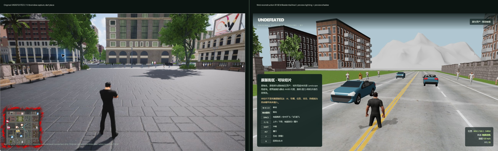
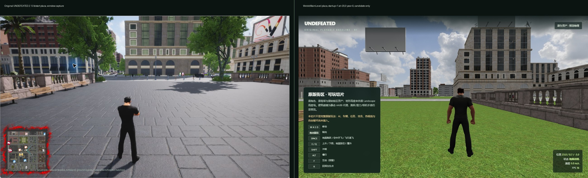
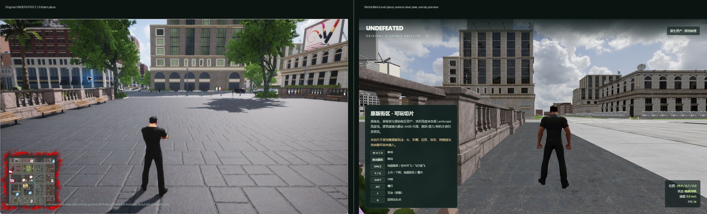

# 原程序与 Web 可玩切片：第一轮视觉对照

日期：2026-10-25。目标：把原程序实际窗口截图和当前 `?view=play` 画面放在一起，先核对角色/相机/光照/UI 的明显差异。**不是同机位、同输入或像素等价验收。**

## 来源

- 原程序：`research/runtime-observation/original-start-plaza.png`，1282×752 窗口截图，裁掉 30 px 标题栏后缩放到 1280×720。原程序版本 2.1.0；启动/进入城市及存档校验见 [report.zh-CN.txt](../research/runtime-observation/report.zh-CN.txt)。
- Web：`research/screenshots/play-fov.jpg`，1280×720，`?view=play`，ResidentialArea1 车道，预览照明 + 预览角色阴影；位置 `(-50.0, 0.0, -548.6)`。相机按原 `PlayerBP` 的 `CameraBoom` 默认值校准：`TargetArmLength=400 cm`、`SocketOffset=(0,50,90) cm`、RelativeLocation Z=70 cm，并把 `Camera.FieldOfView` 按原 90° 水平视场换算；`SetPlayerComponentReference` 会用 CameraBoom 的 400/(0,50,90) 覆盖 HeroComponent CDO 的默认值（`research/evidence/player-logic.json`）。
- 两张图不是同一地点、不是同一相机参数；对照只用于角色外观/相机/光照/UI 的初步差异记录。

## 观察

| 项目 | 原程序 | 当前 Web |
|---|---|---|
| 角色外观 | 黑色短袖/长裤，体型、发型轮廓与当前 Web 角色一致 | 同一原 `hero.gltf`，黑色服装与比例基本一致 |
| 角色阴影 | 角色在铺装上有清晰动态阴影 | 已加入预览角色阴影（跟随预览太阳方向）；级联/软硬/接缝与原版不同 |
| 相机 | 第三人称，角色约占画面高度 1/3，距离更近、略高 | 已按原 `CameraBoom` 400 cm/SocketOffset(0,50,90)/boom Z70 cm 校准，FOV 按 HeroRank 0 的 92° 水平视场，CameraLagSpeed/RotationLagSpeed=15；攻击时插值到 650 cm，CharacterSpeed>60 m/s 时 FarArmLength=800 cm。其它 Far/Zoom 状态、弹簧回弹和碰撞控制仍不同 |
| 光照/雾 | 原版光照、树影、环境雾与高光 | Babylon 预览半球/方向光；无原雾/后处理 |
| 世界 | 起点广场：长椅、树、铺装、成排建筑立面 | ResidentialArea1 街道：砖砌公寓、车道、预览行人和车辆 |
| 远景 | 城市立面/天空，无明显白色山体 | 白色未恢复材质的背景山体非常显眼 |
| UI | 原版小地图、准星、HUD | 自定义检查面板/状态 HUD；没有原版小地图/菜单 |

## MainLevel 起点广场候选

`?view=play&startup=1&at=20,0&yaw=0` 在 MainLevel 原点附近加载全城后，出现石栏杆、古典立面、广告牌、城市街区和原生砖石楼板，构图比单区 CommercialArea 候选更接近原程序起点广场。`?view=play&plaza=1` 是同一检查的快捷预设，默认使用 `(20,0)` 开阔广场姿态（`comparison-start-plaza-native2.jpg`）。

`SM_Floor12000x15000` 的 thin-instance→普通 mesh 材质化修复了原生砖石楼板；`&floors=overlay` 现在只是可选回退，不再默认。

候选姿态补充：`plaza=1&at=-20,0&yaw=0` 是喷泉/右侧栏杆近景（`play-plaza--20-native-trees.jpg`）；`plaza=1&at=-30,-4&yaw=0&exact=1` 是左侧栏杆/花箱/树木构图（`comparison-start-plaza-native.jpg`）；两者都不如 `(20,0)` 开阔，仍不是同机位。

三个已恢复 `StoryStartPoint` 的 startup 检查都没有命中开始广场，见 [story-start-point-audit.zh-CN.md](../research/world-recovery/story-start-point-audit.zh-CN.md)。

原生 floor/树木材质化后，`plaza=1&at=-30,-4&yaw=0&exact=1` 成为当前最新的候选取景：大块石铺装、左侧栏杆/花箱、左中景树木、中央/右侧古典建筑。对照图 `comparison-start-plaza-native.jpg`；仍不是同机位，原程序更开阔、长椅沿左栏杆排布、右侧广告牌不同。

仍不是匹配：长椅/相机/建筑朝向未对齐，overlay 也不是原程序渲染。这是候选地点，不是同机位验收。

## 起点广场候选

`?view=play&district=CommercialArea&at=91,181&yaw=3.14159` 能看到石栏杆、古典拱窗、长椅和开阔广场，和原程序起点广场的元素组合接近（`play-plaza-190.jpg`）。但地面仍是草地（原程序为砖石铺装），建筑/长椅/相机位置也未匹配，因此这是**候选地点**，不是同机位验收。

楼板几何存在但被草地/其它地面遮挡的排查见 [commercial-plaza-ground-investigation.zh-CN.md](../research/world-recovery/commercial-plaza-ground-investigation.zh-CN.md)。

## 结论与下一步

这轮确认了“原角色确实回到原街区、比例/服装方向基本一致”，并补了预览角色阴影，但仍暴露高优先级视觉缺口：

1. 相机已按原 `CameraBoom`/FOV 90 校准，但 Far/Zoom 状态、弹簧回弹、碰撞后的控制曲线仍需对照；
2. 背景山体材质仍为白色，原版雾/光照也没有；
3. 角色阴影只是预览，不是原版阴影级联/后处理；
4. 原版起点广场位置尚未在 Web 场景中定位，不能把 ResidentialArea1 街道当同机位。

下一步优先处理背景山体/雾和相机 lag，再继续寻找原版起点广场/同机位；这些改动不会冒充完整原版渲染等价。
