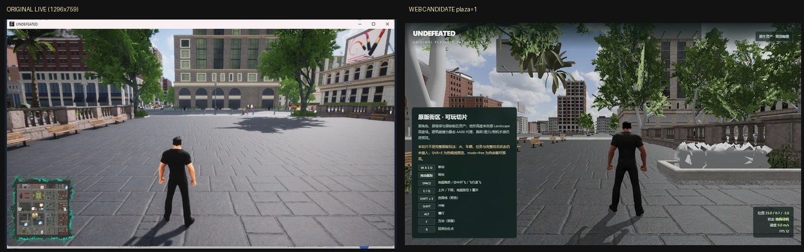

# 原程序开始画面运行时审计（2026-10-25）

目的：停止凭截图猜起点，先拿到原程序真实开始画面和运行环境。

## 方法

- 直接启动 `UNDEFEATED-Win64-Shipping.exe -windowed -ResX=1296 -ResY=759 -nosplash`；
- 键盘/鼠标自动化进入 `GAME START`；
- 窗口截图得到 `original-start-live4.png`（1296×759，含原版 minimap）；
- 对进程做只读内存扫描，搜索 `FMinimalViewInfo` 形状的候选：
  - Location / Rotation / FOV 相邻；
  - 候选示例：location ≈ `(340, -674.19, 327.13)` cm，rotation ≈ `(-10, 90, 0)`，FOV = 90。

## UE4SS 只读运行时挂载

为拿到真实 transform，使用 UE4SS v3.0.1 在**临时 staging 副本**中注入：

- 复制 `UNDEFEATED-Win64-Shipping.exe`、`OpenImageDenoise.dll`、`tbb12.dll` 到临时目录；
- `Content`/`Engine` 用 junction 指回原安装，原安装不被修改；
- UE4SS + `CoordDump` Lua mod 每秒打印 `Pawn` 与 `PlayerCameraManager` 的坐标/旋转。

结果（菜单/标题场景）：

```text
pawn_loc = (-312.000, 943.000, 167.000) cm
pawn_rot = (0.000, 90.000, 0.000)
cam_loc  = (-362.000, 543.000, 327.000) cm
cam_rot  = (-10.000, 90.000, 0.000)
```

这是**菜单角色**的 transform（相机在角色后方 400 cm、高度 327 cm），不是 `GAME START` 后的玩家起点；进入 gameplay 后该 Pawn 未重新绑定，因此不能把它当开始坐标。

`ClientTravel("MainLevel", 0, false)` 与 `ConsoleCommand("open MainLevel")` 均被游戏拒绝，不能用它们绕过菜单。可复现步骤见 `tools/runtime/ue4ss/README.md`。

此外，自动截图/前台窗口切换在本轮遇到了非游戏窗口抢占，已停止该自动化，不做不可靠的截图判断。

## 重要限制

内存候选在多个位置重复出现，可能是相机组件默认值/CDO 或标题画面相机，**尚未用移动后数值变化验证**，不能当作真实玩家坐标。

因此本轮只确认了原程序开始画面本身，不宣称已经拿到同机位坐标。

## 原版开始画面与 Web 当前候选



左：原程序 `GAME START` 后的实际开始画面（1296×759）。
右：当前 Web `?view=play&plaza=1`（`(20,0)`，原生地面/树木）。

肉眼可见差异：

- 原版：左侧石栏杆 + 长椅，中央现代石砌建筑，右侧大幅广告牌，开阔浅色石板广场，左下 minimap；
- Web：喷泉/花坛在右侧，树木更多且位置不同，建筑布局不同，没有右侧广告牌，HUD 是自制面板；
- 原版光照更亮、更暖、更通透；Web 地面偏暗，树影/环境光层次不足；
- 原版相机更高/更远，人物更小；Web 默认 `4 m / 92°` 是 HeroComponent 游戏相机，不一定是开始画面相机。

## 当前判断

可以把当前迁移判定为：

> **视觉还原失败，动作逐帧保留也未完成。**

主要原因按影响排序：

1. 起点世界坐标/相机未确认（本轮只拿到候选，未验证）；
2. UE4 烘焙光照/材质/后处理/天空与 Web 简化管线差异；
3. 大量场景物（广告牌、长椅排布、植被、街道家具）不完整或位置不对；
4. 地面材质 tiling/法线/光照不匹配；
5. 动作：默认 H 用自带动作映射；`homelander-auto` 自动蒙皮 T-pose；`?retarget=1` 手臂畸形；
6. UI/minimap/分辨率不同。

## 下一步

1. 继续只读内存/运行时手段，确认相机/玩家坐标（移动前后差分、相机旋转差分）；
2. 用确认后的坐标重截同机位；
3. 再处理光照/材质/缺失场景；
4. 最后解决原版 18 段动画在 Homelander 骨架上的逐帧绑定。

在没有完成 1-4 前，不应再声称“迁移成功”或“只替换长相完成”。

## 证据

- `original-start-live4.png`：原程序实时开始画面；
- `original-minimap-crop.png`：原版 minimap 放大；
- `comparison-start-live-vs-web.jpg`：同分辨率并排对照；
- `original-start-plaza.png`：用户提供的早期原版开始截图。
