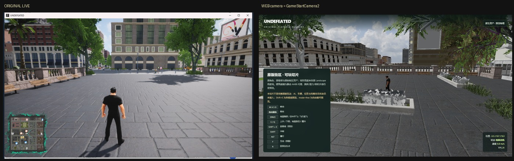
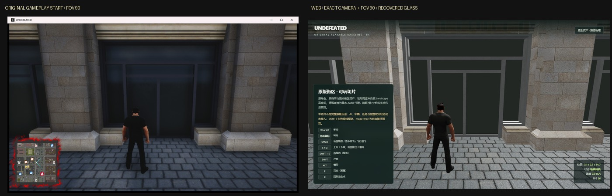
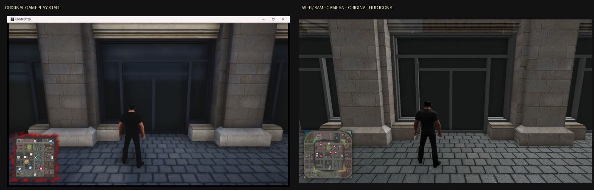
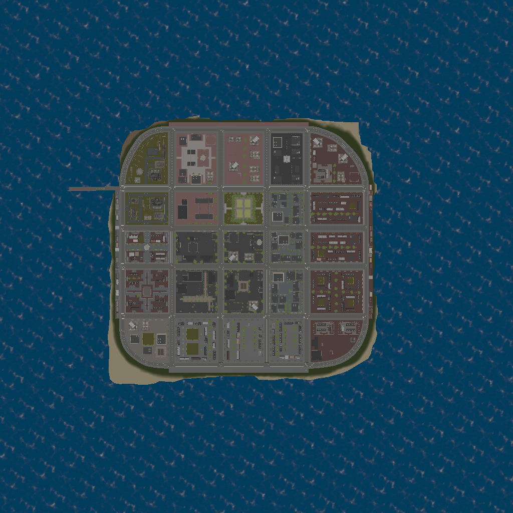

# 原程序开始画面运行时审计（2026-10-25）

目的：停止凭截图猜起点，先拿到原程序真实开始画面和运行环境。

## 方法

- 直接启动 `UNDEFEATED-Win64-Shipping.exe -windowed -ResX=1296 -ResY=759 -nosplash`；
- 键盘/鼠标自动化进入 `GAME START`；
- 窗口截图得到 `original-start-live4.png`（1296×759，含原版 minimap）；
- 对进程做只读内存扫描，搜索 `FMinimalViewInfo` 形状的候选：
  - Location / Rotation / FOV 相邻；
  - 候选示例：location ≈ `(340, -674.19, 327.13)` cm，rotation ≈ `(-10, 90, 0)`，FOV = 90。

## UE4SS 只读运行时挂载

为拿到真实 transform，使用 UE4SS v3.0.1 在**临时 staging 副本**中注入：

- 复制 `UNDEFEATED-Win64-Shipping.exe`、`OpenImageDenoise.dll`、`tbb12.dll` 到临时目录；
- `Content`/`Engine` 用 junction 指回原安装，原安装不被修改；
- UE4SS + `CoordDump` Lua mod 每秒打印 `Pawn` 与 `PlayerCameraManager` 的坐标/旋转。

结果（菜单/标题场景）：

```text
pawn_loc = (-312.000, 943.000, 167.000) cm
pawn_rot = (0.000, 90.000, 0.000)
cam_loc  = (-362.000, 543.000, 327.000) cm
cam_rot  = (-10.000, 90.000, 0.000)
```

这是**菜单角色**的 transform（相机在角色后方 400 cm、高度 327 cm），不是 `GAME START` 后的玩家起点；进入 gameplay 后该 Pawn 未重新绑定，因此不能把它当开始坐标。

`ClientTravel("MainLevel", 0, false)` 与 `ConsoleCommand("open MainLevel")` 均被游戏拒绝，不能用它们绕过菜单。可复现步骤见 `tools/runtime/ue4ss/README.md`。

此外，自动截图/前台窗口切换在本轮遇到了非游戏窗口抢占，已停止该自动化，不做不可靠的截图判断。

## UE4SS actor dump（GameStartCamera）

在 MainLevel 的菜单/初始场景 dump 到：

```text
GameStartCamera1 loc=(-8.0, -1221.0, 16495.0) rot=(-82.377, 97.997, 0)
GameStartCamera2 loc=(857.0, 724.0, 383.0) rot=(-10.294, 169.389, 0)
BP_RespawnAndSpawnPoint_126 loc=(-350.0, 930.0, 17090.0) rot=(0,90,0)
BP_StoryStartPoint2 loc=(19141.098,-24464.004,8455.0)
BP_StoryStartPoint3 loc=(-343.184,2995.804,65.0)
BP_StoryStartPoint_427 loc=(-9979.271,-12698.271,3313.218)
```

用 `GameStartCamera2` 的 transform（UE→Web：x/100、z/100、y/100；yaw 取 `90 - UEyaw`；pitch 为 -0.1796）通过 Web 的检查用绝对相机参数渲染，得到：



右图明显仍不是原版开始画面，说明 `GameStartCamera2` 不是当前开始广场的最终 gameplay 相机（它更像菜单/过场相机），或者开始画面还依赖 PlayerStart/Story 状态，尚未对齐。

Web 新增了仅用于检查的 `?cam=x,y,z&camyaw=&campitch=&fov=` 绝对相机覆盖；默认玩法相机不受影响。

## 真实 gameplay 起点（2026-10-25）

通过 UE4SS 直接调用标题 Blueprint 的 `WBP_TitleSinboard_C:GameStartEvent()`，再调用一次 `InputDone()`，成功走完 intro 并停在真实 gameplay：

```text
pawn_loc   = (-311.999, 7473.891, 167.150) cm
pawn_rot   = (0, 90, 0)
cam_loc    = (-361.999, 7073.891, 327.150) cm
cam_rot    = (-10, 90, 0)
```

UE→Web 换算（`x/100`, `z/100`, `y/100`，yaw 取 `90 - UEyaw`）：

```text
player  = (-3.12, 1.6715, 74.73891) m
camera  = (-3.62, 3.2715, 70.73891) m
```

用该 transform + 实测 FOV 90（`PlayerCameraManager:GetFOVAngle() = 90.000`）绝对相机渲染，与原程序 `PrintWindow` 实抓画面并排：



这是第一张**同一玩家位置、同一相机位置/朝向、同一 FOV** 的对照。建筑柱、门洞、人物位置/比例和地面透视已经对上；`-Window_mat` 与 `Tilable_metal_TintC_Inst` 已用恢复参数从灰玻璃/白框修正为深色玻璃/金属框。剩余差异主要是：

- 原版顶部雨棚/檐口和石材明暗层次更完整；Web 仍偏平；
- 原版有完整 HUD/minimap/任务标识；Web 是自制 HUD；
- 原版有实时角色投影/环境光遮蔽；Web 接触阴影不足；
- 玻璃反射、门内暗部层次和画面比例仍需逐项对齐；
- 人物动作仍需逐帧验证。

结论：**同机位已建立，视觉等价和动作逐帧保留仍未完成。**

## 光照/后处理参数探针

UE4SS 读取 `LightingTest` 子关卡的 `PostProcessVolume`：

```text
AutoExposureMinBrightness = 1.0
AutoExposureMaxBrightness = 8.0
AutoExposureBias          = 0.0
BloomIntensity            = 2.5
DirectionalLight_1 rotation = (-48.61, -55.40, 0)
```

`samples` 里的 DirectionalLight/SkyLight 数值以 UObject 包装返回，暂未取到可靠标量；这些参数属于 `LightingTest` 子关卡，不等于 MainLevel 的烘焙光照，不能直接当作开始广场光照。

尝试过用该 Bloom 值做 Web 预览后处理，但会在门框/玻璃边缘产生原版没有的白边光晕，因此已回退，未作为默认效果。光照/接触阴影仍是 Gate 3 未完成项。

## minimap 静态图恢复

已从 pak 恢复原版 minimap 底图：

```text
/Game/-WorkSpace/Hyodo/MiniMap/NewMinimapSystem/T_StaticMinimap_Tex
```

- `repak` 解包 → `UModel` 导出 1024×1024 Radiance HDR → 解码为 PNG；
- 原版 `BP_WorldCaptureCamera` 用正交 `SCS_BaseColor` capture 生成该图；
- 原版 HUD 通过 `M_NewMiniMapSystem` / `NewMiniMap_Widget` 使用它。

底图文件：`minimap-static.png`。Web 默认 HUD 接入该底图、原版 `map250` 墨迹边框和 `T_PlayerIcon` 玩家箭头，并按 `WorldOrigin/BoxExtent` 的 `[-1300,1300] m` 映射绘制玩家位置；`?hud=help` 才显示探索面板。另用恢复的 `quest_fire` / `quest_accident` 图标，按最近 8 个任务触发点绘制；这不是原版 active-quest 图标状态机，边框随状态的绿/红着色和缩放材质仍未完全恢复。



同一建筑区域（去掉 HUD/窗口边框）实测：

```text
原版 luminance mean=55.8  std=31.3
Web   luminance mean=86.1  std=41.7   # 未校准
Web   luminance mean=58.4  std=31.0   # exposure=0.55
Web   luminance mean=55.6  std=30.1   # exposure=0.55 + default preview AO
```

默认加入 exposure=0.55 + SSAO 预览（`?ssao=0` 关闭，`?exposure=1` 关闭曝光校准）。它只对齐同一机位的整体亮度/对比，不是原版 UE 自动曝光/tone curve/lightmap；原版 auto-exposure/Bloom 仍未重建。



## 历史候选限制

此前菜单 Pawn `(-312,943,167)` 和 `GameStartCamera2` 都不能当作 gameplay 起点；上面的 `(-312,7473.891,167.15)` 才是 intro 结束后的真实玩家位置。

## 当前判断

可以把当前迁移判定为：

> **同机位已建立；视觉等价、原版动作逐帧保留仍未完成。**

主要原因按影响排序：

1. 原版门/窗玻璃、金属框、石材材质与明暗对比未还原；
2. UE4 烘焙光照/后处理/天空与 Web 简化管线差异；
3. 场景物/街道家具/植被不完整或位置不对；
4. 地面 tiling/法线/接触阴影不匹配；
5. 动作：默认 H 用自带动作映射；`homelander-auto` 自动蒙皮 T-pose；`?retarget=1` 手臂畸形；
6. UI/minimap/分辨率不同。

## 下一步

1. ~~确认 gameplay 玩家/相机坐标~~（已完成）；
2. ~~用真实坐标重截同机位~~（第一张同机位已建立）；
3. 处理门/窗材质、光照、HUD 与接触阴影；
4. 最后解决原版 18 段动画在 Homelander 骨架上的逐帧绑定。

在没有完成 3-4 前，不应再声称“迁移成功”或“只替换长相完成”。

## 证据

- `original-start-live4.png`：原程序实时开始画面；
- `original-minimap-crop.png`：原版 minimap 放大；
- `comparison-start-live-vs-web.jpg`：早期非同一状态并排对照；
- `original-gameplay-start-final.png`：intro 结束后的真实 gameplay 起点实抓；
- `comparison-live-gameplay-start-web-v3.jpg`：同一玩家/相机/FOV 的 Web 对照；
- `minimap-static.png`：从 `T_StaticMinimap_Tex` 恢复的 1024×1024 原版 minimap 底图；
- `original-start-plaza.png`：用户提供的早期原版截图。
